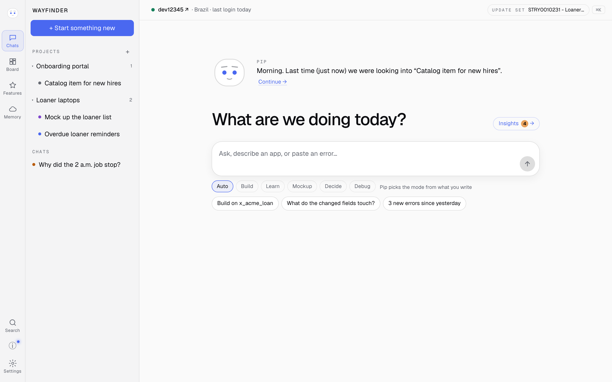

# Wayfinder

Wayfinder is a self-hosted ServiceNow workspace with an AI companion, Pip, connected to your own instance.
Use one browser tab to learn from the docs, investigate errors, preview screens and build scoped apps. Pip checks
what your instance already offers and asks before making changes, so you can review work before it reaches your instance.



## What you need

- A ServiceNow instance or personal developer instance (PDI), available from [developer.servicenow.com](https://developer.servicenow.com).
- An **Anthropic API key**, billed to your Anthropic account. Save it during setup or set `ANTHROPIC_API_KEY`.
  A Claude subscription or CLI login alone does not work.
- For installers and source: **Node.js 22.13+**, npm and git on macOS, Linux or Windows through WSL.
  The installer can help install Node. Native Windows is not supported.
- For Docker: Docker Engine with Compose; Node and git inside the image are included. Git is needed to clone the repo.

## Quick start

Replace `__PUBLIC_REPO__` with the public `owner/repository` when it is named.
The install scripts need a published release; **use source or Docker until the first release is available**.

### macOS / Linux installer

1. Install:
   ```sh
   curl -fsSL https://github.com/__PUBLIC_REPO__/releases/latest/download/install.sh | sh
   export PATH="$HOME/.local/bin:$PATH"
   ```
2. Start and print your login token:
   ```sh
   wayfinder start
   wayfinder token
   ```
3. Open http://127.0.0.1:8797, paste the token and follow [first-run setup](#first-run-setup).

### Windows (PowerShell → WSL)

1. Install WSL if needed (`wsl --install` in an administrator PowerShell, restart, then open Ubuntu once).
2. In PowerShell, install and start Wayfinder:
   ```powershell
   irm https://github.com/__PUBLIC_REPO__/releases/latest/download/install.ps1 | iex
   ```
3. The installer prints your token and opens the browser. Paste the token and follow [first-run setup](#first-run-setup).

### Docker Compose

1. Clone:
   ```sh
   git clone https://github.com/__PUBLIC_REPO__ wayfinder
   cd wayfinder
   ```
2. Build, start and print your login token:
   ```sh
   docker compose up --build -d
   docker compose exec wayfinder npx tsx src/server/token.ts
   ```
3. Open http://127.0.0.1:8797, paste the token and follow [first-run setup](#first-run-setup).

### From source

1. Clone:
   ```sh
   git clone https://github.com/__PUBLIC_REPO__ wayfinder
   cd wayfinder
   ```
2. Install, build and test:
   ```sh
   npm ci --ignore-scripts && npm run build && npm test
   ```
3. Print your token, then start the server. Open http://127.0.0.1:8797 and follow [first-run setup](#first-run-setup):
   ```sh
   npm run token
   npm start
   ```

## First-run setup

Save and test your Anthropic API key, connect your instance, then review the optional extras.
For a new PDI, **Set up my PDI for me** previews the changes before you approve them: an integration user,
an OAuth app and a property allowing client-credentials sign-in. It uses the admin password once without saving it.

You can also connect in Settings → Instances:

| Sign-in | What to supply |
|---|---|
| Integration user (OAuth client credentials) | Instance URL, client ID and secret from an inbound client-credentials integration linked to your integration user. |
| Sign in as me (OAuth with PKCE) | Instance URL and client ID from an authorization-code integration. Register your Wayfinder address plus `/api/oauth/callback` as its redirect URL; sign in through the instance and your SSO. |
| Username and password (opt-in) | Instance URL and a dedicated account's username and password. Prefer OAuth when available. |

Use a placeholder such as `https://dev12345.service-now.com` only as an example; enter your own instance address.
Wayfinder works within the connected account's roles. `admin` and `sn_cicd.sys_ci_automation` enable the full PDI
setup, plugin installs and app builds; fewer roles limit what it can do. Company and vendor instances require explicit
opt-in and cannot use chat Auto mode or Full permissions.

Optional: download ServiceNow docs in Settings → Pip (needs git and about 1.5 GB), install `bubblewrap` on Linux
for isolated builds, or set up local voice transcription. See the [runbook](docs/RUNBOOK.md).

## Data and updates

Chats, projects, app source and backups live in `~/wayfinder-data`; credentials and tokens live in
`~/.config/wayfinder/secrets.json`. The folders are private to your account. Secrets are sealed through the macOS
Keychain or Windows Credential Manager in WSL when available; on other Linux systems they are stored in a private
plain file. Override the folders with `WAYFINDER_DATA_DIR` and `WAYFINDER_CONFIG_DIR`.
Docker stores them in the `wayfinder-data` and `wayfinder-config` volumes.

- Installer: `wayfinder update` checks the download, restarts and rolls back if its health checks fail.
- Source: stop the server, run `git pull && npm ci --ignore-scripts && npm run build && npm test`, then `npm start`.
- Docker: run `git pull && docker compose up --build -d`. Keep the volumes to keep your data.

Back up both data and config before moving machines. See the [runbook](docs/RUNBOOK.md) for backups,
services, logs, troubleshooting and optional features.

## Security

Wayfinder binds to localhost (`127.0.0.1:8797`); Compose also publishes only on localhost. Use a private network
to reach it from other devices. Keep it off the public internet and treat the login token like a password.

Messages and tool results, including instance data Pip reads, go to Anthropic. Instance credentials stay on your
machine. Changes require approval by default; optional PDI auto-approval settings broaden that permission.
Generated apps build in a bubblewrap sandbox on Linux when available. **On macOS and in Docker that build sandbox
is off**: generated code runs with Wayfinder's permissions and can read its secrets. See [SECURITY.md](SECURITY.md)
and [data handling](docs/DATA.md) before connecting sensitive instances or adding tool servers.

## Contributing and license

See [CONTRIBUTING.md](CONTRIBUTING.md) for development and checks. Wayfinder is licensed under
[Apache 2.0](LICENSE); dependencies retain their own licenses. Credits are in [NOTICE](NOTICE).

ServiceNow is a trademark of ServiceNow, Inc. Wayfinder is independent and is not affiliated with, sponsored by
or endorsed by ServiceNow, Inc.
